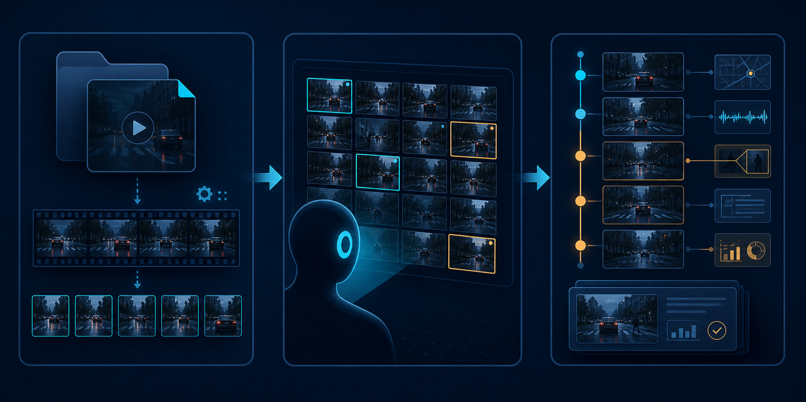

# Video Analyst

**Agent-assisted local video analysis workflow.**

Local Python / FFmpeg scripts handle media processing.
The **current conversation Agent** inspects extracted frames and writes visual analysis.


Video Analyst is a local-first Skill for turning a video into inspectable,
timestamped visual evidence. It prepares deterministic media inputs, pauses for
the current conversation Agent to actually open the images, and then validates
the Agent's existing analysis schemas before producing a report.

```text
本地脚本粗抽帧
→ 当前对话 Agent 真正查看图片
→ 当前 Agent 写 coarse analysis 和 refinement plan
→ 本地脚本按照 plan 详细抽帧
→ 当前 Agent 真正查看精细帧
→ 当前 Agent 写 fine analysis
→ 本地脚本聚合并生成最终报告
```

## Product principles

| Responsibility | Owner |
|---|---|
| Video precheck, ffprobe, audio, ASR, subtitles | Local scripts |
| 1 FPS coarse frames, scene frames, contact sheets | Local scripts |
| Adaptive 5/10/15 FPS refinement frames + detail frames | Local scripts |
| Schema validation, evidence checks, aggregation, reports | Local scripts |
| **Actually looking at images** | **Current conversation Agent** |
| Coarse analysis + refinement plan | Current conversation Agent |
| Fine / terminal analysis | Current conversation Agent |

```text
脚本不做视觉推理。
当前对话 Agent 不负责媒体抽帧。
```

### What this product is **not**

- Not an automatic vision-API pipeline
- Not a mock vision provider product
- Not an agent-CLI / task-pack import-export tool
- Does **not** require vision API Key / Base URL / model website

### What you still need (optional, ASR only)

- Python 3.11+
- FFmpeg + ffprobe
- Optional: `GROQ_API_KEY` for Groq Whisper ASR / subtitle calibration
- Optional: local Whisper (`pip install 'video-analyst[local-whisper]'`)
- A conversation Agent that can **read images** and write local files

## Install

```bash
pip install -e .
pip install -e '.[dev]'
```

After installing the package, run the explicit setup command. It installs
missing **FFmpeg + ffprobe** and the official **yt-dlp** executable by default
into the shared Video Analyst tools directory. The package installation itself
does not silently execute network downloads.

```bash
video-analyst setup --yes
```

Skip either dependency when it is already managed by your machine:

```bash
video-analyst setup --yes --no-ffmpeg
video-analyst setup --yes --no-yt-dlp
video-analyst setup --yes --no-ffmpeg --no-yt-dlp
```

Use `video-analyst doctor --json` to verify Python, FFmpeg, ffprobe, and
yt-dlp. yt-dlp is needed only for the explicit public-URL import layer; the
core local-file pipeline does not require a URL downloader.

## Unique five-stage pipeline

```text
Stage 1  prepare                 local scripts
Stage 2  coarse-agent-analysis   current Agent looks at images
Stage 3  refine-prepare          local scripts
Stage 4  fine-agent-analysis     current Agent looks at images
Stage 5  finalize                local scripts (deterministic)
```



Optional one-shot terminal refinement between Stage 4 and 5 (never a third round).

## CLI (product commands)

```bash
video-analyst doctor
video-analyst import-url URL -o OUTPUT --subtitle-language all
# → writes OUTPUT/source/video.* and OUTPUT/source/manifest.json
video-analyst prepare VIDEO -o OUTPUT
# → Agent inspects analysis/coarse/inputs/ and writes coarse JSON
video-analyst inspect-prepare VIDEO -o OUTPUT --at 12.5 --at 01:03
# → independent sidecar under analysis/inspection/; does not change workflow state
video-analyst validate-coarse OUTPUT
video-analyst refine-prepare VIDEO -o OUTPUT
# → Agent inspects fine contact sheets / detail frames and writes fine JSON
video-analyst validate-fine OUTPUT
# optional:
video-analyst terminal-prepare VIDEO -o OUTPUT
video-analyst validate-terminal OUTPUT
video-analyst finalize VIDEO -o OUTPUT
video-analyst status OUTPUT
video-analyst clean OUTPUT --all-generated
```

`import-url` (also available as `download-source`) is an explicit public URL
import layer. It defaults to `--no-playlist`, supports ordinary public Bilibili
single-video URLs, and accepts `zh-Hans`, `zh-Hant`, `zh`, `ja`, `en`, or `all`
subtitle selection. Browser sessions are never read; cookies are used only
when an explicit `--cookies FILE` is supplied and are not copied into the
source manifest. The resulting local path must be passed to `prepare`; URL
handling is not implicit in the local-file pipeline.

`inspect-prepare` (alias `focus-prepare`) accepts repeated absolute `--at`
timestamps and strict `--start` / `--end` bounds in `SS`, `MM:SS`, or
`HH:MM:SS` form. Its `--fps` is limited to 5, 10, or 15. The manifest lists
directly openable absolute frame paths, timestamps, and contact sheets; pinned
frames are protected from pixel-only dedupe. Inspection is a sidecar and never
writes coarse/fine analysis JSON or advances workflow status.

`video-analyst run VIDEO -o OUTPUT` advances **local** stages only and **pauses**
when the Agent must inspect images. It never invents visual analysis via mock
or external APIs.

```text
STATUS: waiting_for_coarse_agent_analysis
STATUS: waiting_for_fine_agent_analysis
```

Legacy aliases still available for ASR-only work:

```bash
video-analyst analyze VIDEO -o OUT   # ASR + phase2 prep (prefer prepare)
video-analyst review -o OUT --use asr|llm
```

Removed from the product path:

```text
provider-check, coarse-analyze, fine-analyze with vision providers
mock / openai-compatible / anthropic-compatible vision modes
vision API Key / Base URL / model website requirements
```

## User workflow (with a coding Agent)

1. Ask the Agent to run `video-analyst prepare VIDEO -o OUT`
2. Agent **opens and views every listed coarse frame and contact sheet**, aligning each observation to the manifest timestamp
3. Agent writes coarse analysis + refinement plan (existing schemas)
4. Agent runs `validate-coarse` then `refine-prepare`
5. Agent **opens and views every listed fine contact sheet and detail frame**, requesting on-demand `--at` inspection frames when a question remains unresolved
6. Agent writes fine analysis (existing schemas)
7. Agent runs `validate-fine` then `finalize` (or terminal once if needed)
8. User opens `report/report.md`

A plain terminal without an image-capable Agent **cannot** complete vision stages.

Transcript and subtitle text are supporting context only. The Agent may choose
to request an explicit `inspect-prepare --at ...` frame after reading a cue,
but no script parses transcript language or other text to infer a semantic
moment, scene, motion, or transition. `finalize` consumes only validated
existing Pydantic coarse/fine/terminal schemas and real `EVID-*` evidence; it
never consumes free-form inspection notes.

## Output layout

```text
OUT/
  metadata/
  media_info.json
  audio/
  asr/
  subtitles/
    subtitles.json              # ACTIVE
  phase2/
    frames_1fps/
    frames_scene/
    frames_pinned/            # optional explicit --at coarse frames
    visual_batches.json
  analysis/
    coarse/
      inputs/                   # Agent MUST inspect these images
        manifest.json
        batches/
        frames/
        contact_sheets/
      batches/<batch_id>.json   # Agent writes CoarseBatchAnalysis
      video_structure.json
      refinement_plan.json
    inspection/               # independent inspect-prepare sidecar
      manifest.json
      frames/
      dropped_candidates/
      contact_sheets/
    refinement/                 # Stage 3 local extraction
      frames/
      contact_sheets/
      detail_frames/
      visual_inputs/fine_batches.json
    fine/                       # Agent writes FineBatchAnalysis
      batches/
      temporal_events.json
      fine_video_analysis.json
      second_refinement_plan.json
    terminal_refinement/        # optional local extraction
    terminal_fine/              # optional Agent write
  report/
    report.json
    report.md
    shot_table.csv
    event_table.csv
    unresolved_items.csv
  cache/workflow_state.json
```

## Refinement FPS rules (Agent must follow)

| FPS | Use for |
|---|---|
| 5 | Normal continuous motion, slow text/graphic change |
| 10 | Faster motion, text enter/exit, scale/pan/mask, transitions |
| 15 | Very short transitions, flash, fast UI/text, unresolved 10 FPS boundaries |

Do **not** sample the entire video at 15 FPS. Prefer short intervals and the
lowest FPS that answers the refinement questions.

## Provenance (every run)

```text
vision_execution_mode = in_session_agent
real_vision_analysis_used = true
external_api_used = false
api_key_used = false
token_status = unavailable
estimated_cost = null
pricing_source = in_session_agent
```

Costs are **not** written as `0` when unknown.

## Environment variables

| Variable | Purpose |
|---|---|
| `GROQ_API_KEY` | Optional Groq Whisper / calibration (ASR only) |
| `VIDEO_ANALYST_TOOLS_DIR` | Optional tools root (default `~/.video-analyst/tools`) |

Vision API keys are **not used** by the product path.

## Tests & build

```bash
python -m pytest -q
python -m build
```

## License

MIT
